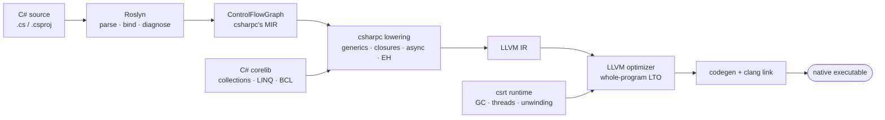
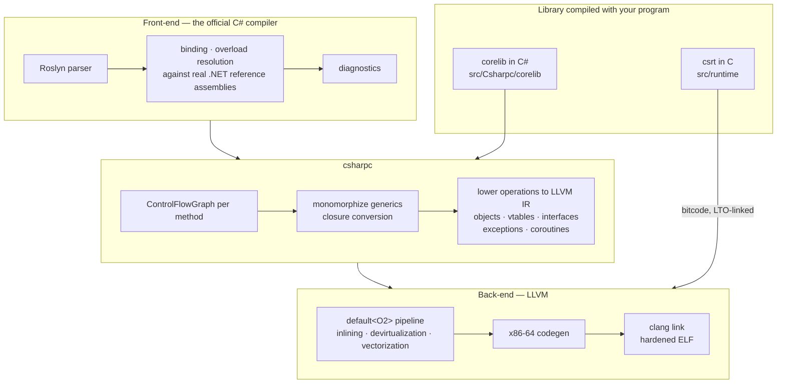
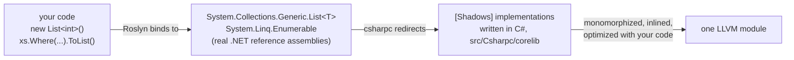
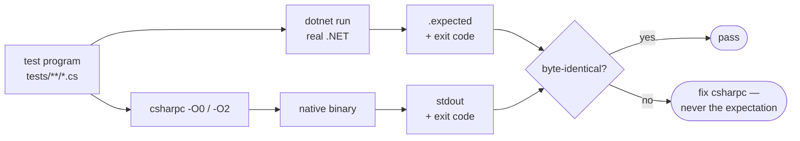

<div align="center">

# csharpc

**A C# front-end for LLVM.**
csharpc compiles C# source code straight to LLVM IR and then to small, fast native executables —
what `clang` is to C, `rustc` to Rust and `gollvm` to Go.

[](https://github.com/jonathanperis/csharpc/actions/workflows/ci.yml)


</div>



csharpc is written in C# (.NET 11). It uses **Roslyn** as its parser and type checker — so every
diagnostic, overload resolution and language rule is exactly the official compiler's — and the
**LLVM C API** as its backend. Everything in between is csharpc: lowering Roslyn's control-flow graph
to LLVM IR, the object model, a garbage-collected runtime, a C# corelib, and the driver. No IL, no JIT
and no CoreCLR at run time: the output is an ordinary native executable.

```console
$ csharpc hello.cs -o hello && ./hello
Hello from C# compiled by LLVM!
$ ls -lh hello
-rwxr-xr-x 1 dev dev 32K hello
```

## Highlights

- **Real C#, verified against real .NET.** Every test program runs under `dotnet run` (the oracle)
  and under csharpc, and the outputs must be byte-identical. **100 %** of the
  [195-program conformance corpus](docs/09-conformance.md) passes, with zero silent miscompilations.
- **Fast.** On [20 benchmark programs](benchmarks/RESULTS.md), measured by CI on clean x86-64 and arm64
  runners, csharpc beats the .NET JIT on every one and beats or ties NativeAOT on 16 of 20 on x86-64
  (CPU time), with binaries **8–120× smaller** (11–161 KiB vs 1.3–1.6 MiB on x86-64; hello world is
  27 KiB with default hardening), faster start-up and a fraction of the memory
  ([size, start-up and memory](benchmarks/RESULTS.md#size-start-up-memory-and-compile-time)).
- **Drop-in.** Compile a `.csproj` directly, or keep using `dotnet build` / `dotnet publish` with
  `-p:UseCsharpc=true` / `-p:PublishCsharpc=true` ([docs/08-drop-in.md](docs/08-drop-in.md)).
- **Debuggable.** `-g` emits DWARF: breakpoints on C# lines, C# names in backtraces, locals in gdb/lldb.
- **Whole-program optimization.** Closed-world compilation: internal linkage everywhere, class-hierarchy
  devirtualization, generics monomorphized, and the runtime itself LTO-linked into your program.

## Language and library support

| | |
|---|---|
| **Types** | classes, structs, records (class & struct), enums, interfaces (default & static abstract members), generics (monomorphized, constraints, variance, generic math), tuples, `Nullable<T>`, anonymous types, delegates & events, arrays (incl. multi-dimensional), `Span<T>`/`Memory<T>`, pointers & `unsafe`, `decimal`, `BigInteger` |
| **Code** | lambdas & closures, local functions, all statements, `switch` expressions, every pattern kind (type, property, positional, list, relational, logical), `try`/`catch`/`finally`/filters, `checked`, `using`, `lock`, iterators, `async`/`await`, `await foreach`, LINQ (method and query syntax), C# 14 extension members, primary constructors, `required`/`init`/`field` |
| **Runtime** | conservative garbage collector (thread-safe, stop-the-world), real threads (`Thread`, `Monitor`, `Interlocked`, `Parallel`), Itanium-ABI exceptions with .NET's exact messages, async scheduler on LLVM coroutines |
| **Library** | `Console`, `Math`, strings & `StringBuilder`, number formatting/parsing (all standard and custom format strings), `DateTime`/`TimeSpan`/`Stopwatch`, `Type` objects, `System.Collections.Generic` and `System.Linq` (a corelib written in C# and compiled with your program), tasks, cancellation |

Not supported, by design or for now (the same limits NativeAOT has in the first group):
`dynamic`, runtime code loading and member reflection; NuGet packages that ship only IL; file and
network I/O beyond the console. The full matrix is in [docs/06-roadmap.md](docs/06-roadmap.md).

## Quick start

Requirements: Linux (x86-64 or ARM64), macOS on Apple silicon or Windows x64 (WebAssembly is a
cross target, see below), the .NET 11 SDK,
LLVM 18 (`libLLVM-18.so`, Homebrew's `llvm@18` on macOS, or [LLVM-MinGW](https://github.com/mstorsjo/llvm-mingw)
on Windows; 19/20 are also probed) and `clang` (linker driver and runtime compiler).

```bash
# .NET 11 (side by side in ~/.dotnet11)
curl -sSL https://dot.net/v1/dotnet-install.sh | bash -s -- --channel 11.0 --quality preview --install-dir ~/.dotnet11
export PATH=$HOME/.dotnet11:$PATH

# LLVM 18 + clang (Ubuntu 24.04)
sudo apt install llvm-18 clang-18
# ...or on macOS (Apple silicon; Xcode Command Line Tools provide the SDK and the linker)
brew install llvm@18 && export PATH="$(brew --prefix llvm@18)/bin:$PATH"
# ...or on Windows (Git Bash): LLVM-MinGW 20240619 (LLVM 18, UCRT), unzipped, with its bin/ on PATH
export PATH="/c/llvm-mingw-20240619-ucrt-x86_64/bin:$PATH"

# Build csharpc
git clone https://github.com/jonathanperis/csharpc && cd csharpc
dotnet build src/Csharpc -c Release
alias csharpc="dotnet $PWD/src/Csharpc/bin/Release/net11.0/csharpc.dll"

# Compile and run
cat > hello.cs <<'EOF'
var primes = Enumerable.Range(2, 50).Where(n => Enumerable.Range(2, (int)Math.Sqrt(n) - 1).All(d => n % d != 0));
Console.WriteLine($"Hello from C# compiled by LLVM! Primes: {string.Join(", ", primes)}");
EOF
csharpc hello.cs -o hello && ./hello
```

For fast compiles, build csharpc itself as a native executable (about 5× less CPU per compile):
`tools/publish-native.sh`, then use `artifacts/csharpc-native/csharpc`.

If libLLVM isn't on the default library path set `CSHARPC_LIBLLVM=/path/to/libLLVM.so`; to use another
C compiler or linker driver pass `--cc` or set `CSHARPC_CC`.

### WebAssembly (WASI)

```bash
# the WASI SDK 24 (LLVM 18, like csharpc) and wasmtime
export WASI_SDK_PATH=/opt/wasi-sdk
csharpc --target wasm32-wasip1 hello.cs -o hello.wasm && wasmtime run --dir=. hello.wasm
```

The same programs run as WebAssembly modules, and the CI checks them against .NET under wasmtime.
WebAssembly has no threads (`Thread.Start` throws `PlatformNotSupportedException`, as in .NET's
single-threaded WebAssembly builds), no sockets and no dynamic libraries
([ADR 0010](docs/adr/0010-wasm32.md), [docs/04-runtime.md](docs/04-runtime.md#webassembly-wasm32-wasip1)).

### Building real projects

```bash
csharpc path/to/App.csproj                 # evaluates the project with MSBuild; ProjectReferences included
dotnet build   -p:UseCsharpc=true          # with the Csharpc.Sdk package: native exe replaces the apphost
dotnet publish -p:PublishCsharpc=true      # one native executable, like PublishAot
dotnet pack src/Csharpc && dotnet tool install -g csharpc --add-source src/Csharpc/bin/Release   # as a dotnet tool
```

## Command line

```
csharpc [options] <file.cs>...
csharpc [options] [<project.csproj> | <directory>]

  -o, --output <path>     Output file, or directory for <AssemblyName>
  -c, --configuration <c> Debug (default) | Release, like dotnet: #if symbols and project properties
  -p:<Name>=<Value>       MSBuild property used when evaluating a project
  --emit <kind>           exe (default) | obj | asm | llvm-ir | llvm-bc
  -O0 | -O1 | -O2 | -O3   Optimization level (default -O2)
  -Os | -Oz               Optimize for size (-Oz: smallest)
  --static                Fully static executable (static-pie, no shared libraries)
  --strip | --no-strip    Strip symbols (default: strip unless -g)
  -g, --debug             DWARF debug info (C# source-level debugging)
  --target <triple>       Target triple (default: host)
  --cpu <name>            native, x86-64-v3, znver4, ... (default: best x86-64-vN of the host)
  --dump-cfg              Print Roslyn's control-flow graphs (csharpc's "MIR")
  --intrinsics            List the library members implemented by the runtime
  -v, --verbose           Pipeline phases and timings
```

## Why LLVM?

LLVM separates a language from its machine code: a front-end only has to translate the language to
LLVM IR, and gets a world-class optimizer, every CPU target and the surrounding tooling (linkers,
debuggers, sanitizers) for free. That is how clang, rustc, Swift and Zig work — and the idea behind
csharpc: Roslyn already knows C# perfectly, LLVM already knows machines perfectly, and csharpc is the
bridge between them. For an introduction to why that design is so effective:

<a href="https://www.youtube.com/watch?v=3WojCM9r0Ls"></a>

*[Why LLVM is a Game Changer for Compilers](https://www.youtube.com/watch?v=3WojCM9r0Ls) — The Coding Gopher*

## How it works



1. **Front-end — Roslyn.** Parsing, binding, overload resolution and diagnostics come from the official
   C# compiler, bound against the real .NET reference assemblies, so language semantics are exactly
   the official compiler's.
2. **Middle — Roslyn's `ControlFlowGraph` as MIR.** Loops, `&&`/`||`, `?:`, `??`, `?.`, `switch` and
   patterns arrive already lowered to basic blocks, much like rustc's MIR. csharpc maps blocks 1:1 to
   LLVM blocks and lowers each operation, with entry-block `alloca`s that `mem2reg` promotes (the clang
   strategy). Generics are monomorphized; closures, iterators, `async` (LLVM coroutines), exceptions
   (`invoke`/`landingpad`), records and the rest are lowered by csharpc itself.
3. **Library — corelib + csrt.** The .NET library surface is implemented in C# wherever possible
   (`src/Csharpc/corelib`) and compiled together with your program; a small C runtime
   (`src/runtime`) provides the GC, stack unwinding, threads and the OS boundary.
4. **Back-end — LLVM.** The module, with the runtime's bitcode linked in, goes through LLVM's
   optimization pipeline and the target backend; `clang` links a hardened executable.

### The C# corelib: your code binds to .NET, runs on csharpc



Overload resolution, IDE experience and diagnostics stay exactly .NET's; only the implementation
behind the symbols is csharpc's — closed-world, specialized for your program, and dead-stripped.

Read [docs/02-architecture.md](docs/02-architecture.md), [docs/03-lowering.md](docs/03-lowering.md) and
[docs/12-corelib.md](docs/12-corelib.md) for the details, and [docs/01-prior-art.md](docs/01-prior-art.md)
for how this compares to Mono's LLVM backend, LLILC, NativeAOT(-LLVM), IL2CPP and bflat.

## Repository layout

```
src/
  Csharpc/          the compiler: Frontend (Roslyn), CodeGen (CFG → LLVM IR), Llvm (C API bindings), Driver
  Csharpc/corelib/  the BCL in C#: collections, LINQ, strings, StringBuilder, number formatting/parsing,
                    decimal, BigInteger, DateTime; compiled with every program
  Csharpc.Sdk/      MSBuild integration (UseCsharpc / PublishCsharpc)
  runtime/          csrt — the C runtime: GC, exceptions, threads, async scheduler, console/OS calls
tests/
  samples/          differential tests (each .cs has .expected output recorded from real .NET)
  conformance/      the 195-program C# conformance corpus
  projects/         multi-project solutions for the drop-in / MSBuild tests
  run.sh, conformance.sh, projects.sh, debuginfo.sh
benchmarks/         benchmark programs, harness (run.sh) and RESULTS.md
docs/               architecture, lowering, runtime, roadmap, ADRs, spike log
tools/              gdb and lldb pretty-printers for csharpc binaries
```

## Testing

Real .NET is the oracle: every test program runs under `dotnet run` once to record its output, and
csharpc's binaries must reproduce it byte for byte, at every optimization level, on every commit.



```bash
tests/run.sh --all-opts     # differential suite at -O0 and -O2 (compares against recorded .NET output)
tests/run.sh --regen 42     # re-record expectations for samples matching "42" with real .NET
tests/conformance.sh -j 4   # conformance corpus, per-area coverage report
tests/programs.sh           # larger real-world programs (interpreter, JSON, ray tracer, ...)
tests/projects.sh           # csproj input, dotnet build/run/publish integration
tests/debuginfo.sh          # gdb-driven debug-info checks
benchmarks/run.sh           # csharpc vs .NET JIT vs NativeAOT
```

See [docs/05-testing.md](docs/05-testing.md).

## Documentation

| | |
|---|---|
| [00 Vision](docs/00-vision.md) · [01 Prior art](docs/01-prior-art.md) · [02 Architecture](docs/02-architecture.md) · [03 Lowering](docs/03-lowering.md) | how csharpc is built and why |
| [04 Runtime](docs/04-runtime.md) · [10 Async](docs/10-async.md) · [11 BCL value types](docs/11-bcl-value-types.md) · [12 Corelib](docs/12-corelib.md) · [14 Threading](docs/14-threading.md) | the runtime and library |
| [05 Testing](docs/05-testing.md) · [09 Conformance](docs/09-conformance.md) · [13 Debugging](docs/13-debugging.md) · [08 Drop-in](docs/08-drop-in.md) | using and verifying it |
| [06 Roadmap](docs/06-roadmap.md) · [07 Spike log](docs/07-spike-log.md) · [ADRs](docs/adr/) | where it's going and how it got here |

## Project status

csharpc is **pre-1.0** and under active development. What that means in practice:

| | |
|---|---|
| **Guarantee** | A compiled program behaves exactly like it does on .NET — same output, same exceptions and messages, same exit code. Anything csharpc can't compile faithfully is rejected at compile time with a `CSLLVM0001: not supported by csharpc yet` diagnostic; a silent behavioral difference is treated as the highest-priority bug. |
| **Verified surface** | The language and library features in the table above, checked on every commit by CI: the differential samples at `-O0` and `-O2`, the conformance corpus, and a set of larger real-world programs. |
| **Platforms** | Linux x86-64, Linux ARM64, macOS ARM64 (Apple silicon) and Windows x64 (MinGW-w64 toolchain, `x86_64-w64-windows-gnu`), each tested in CI against real .NET on that machine. WebAssembly is on the [roadmap](docs/06-roadmap.md). |
| **Not supported** | `dynamic`, member reflection and runtime code loading (the same limits NativeAOT has); NuGet packages that ship only IL (an IL front-end is planned); parts of the BCL such as networking, regular expressions and JSON, which grow with the corelib. |
| **Stability** | Whole-program compilation with no stable ABI between csharpc versions: rebuild everything when you upgrade. Command-line options may still change. |

Found a gap? Open an issue with a **minimal program** and what `dotnet run` prints — the differential
test format turns every report directly into a regression test. Contributions are welcome; see
[docs/CONTRIBUTING.md](docs/CONTRIBUTING.md) (and [AGENTS.md](AGENTS.md) for automated coding agents).

## License

[MIT](LICENSE)
